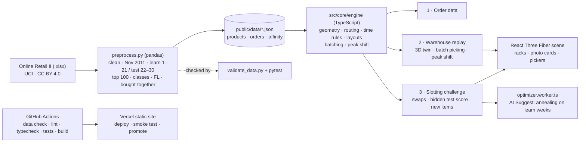

# Pick & Pack — Warehouse Digital Twin

NEXAI 2026 Hackathon · Track 4 · PS 4.2

A browser game that turns warehouse slotting into a puzzle, set in **Holly & Ivy Gifts**, a UK gift and
Christmas-décor wholesaler in its November rush (the company name is ours; the orders are real November 2011 orders
from Online Retail II). A 3D twin of the picking floor replays those orders. You rearrange 100 products; the twin
replays exactly the same orders and scores walking distance and pick time before vs after.

**Live:** https://nexai-jayesh-panis-projects.vercel.app · **Team:** Jayesh Pani, Megha Gautam, Meet Kumar ·
**Pitch, demo script and Q&A:** [docs/PITCH.md](docs/PITCH.md) · **Development log:** [DEV_LOG.md](DEV_LOG.md)

The project merges two branches of the same plan: this one (modules, product photos, time rules with forklift
handling levels, deployment) and Megha Gautam's (explained AI Suggest with a business case, hidden test-week score,
batch picking, peak-day shift, new-product slotting, Python data tests, pitch kit). Commits carry both authors.

## Modules

The app opens on a home screen with three separate modules, one per must-have requirement.

| # | Module | Requirement | Code |
|---|---|---|---|
| 1 | **Order data** | Pre-processing: one month of order lines turned into JSON (top 100 products, pick counts, orders), plus cost class, FL, categories and the time rules | `preprocess.py`, `src/modules/data` |
| 2 | **Warehouse replay** | 3D warehouse (racks with product photos, aisles, packing dock, animated picker) replaying orders with live distance and time. Stretch goals: **batch picking** and a **peak shift with several pickers and congestion** | `src/modules/twin` |
| 3 | **Slotting challenge** | Swap products between slots, replay the same orders, compare walking and pick time against the automatic baseline. Plus **AI Suggest** (explained moves, payback), **new-product slotting**, heatmap and leaderboard | `src/modules/game` |

`src/core` holds what all three share: the simulator (`engine/`: geometry, routing, scoring, layouts) and data
loading. The replay module is read-only: no swapping, scoring or optimiser. Everything game-related lives in
module 3, which reuses the replay's 3D scene. `src/modules/boundaries.test.ts` fails the build if a module
imports one it shouldn't (core imports no module; data and replay never import the game).

## Architecture



Everything runs in the browser: there is no backend and no secret is needed to run the app. The data is
prepared once by `preprocess.py` and committed as JSON; the simulator, the optimiser (in a Web Worker so the
scene never freezes) and the 3D scene all read the same engine, so the animation and the score cannot disagree.

## Tech stack

| Layer | Tools |
|---|---|
| Data preparation | Python 3.10+, pandas, openpyxl, pyarrow; pytest for the data rules |
| Simulation engine | TypeScript (pure functions), Vitest |
| 3D and UI | React 19, Three.js, React Three Fiber, drei, zustand; Vite 8 |
| Optimiser | Simulated annealing in a Web Worker |
| Quality | oxlint, TypeScript typecheck, Vitest, pytest, `scripts/validate_data.py` |
| Delivery | GitHub Actions CI/CD, Vercel (static hosting) |

Exact versions are in `package.json` and `requirements.txt`. Product photos come from Wikimedia Commons (credits in
`public/products/credits.json`).

## How to play (module 3)

The challenge opens on its own menu: **Challenge**, **Sandbox**, **How to play** and **High scores**.

- **Challenge:** start from the Baseline (fast movers nearest the dock) with **10 swaps**. Click a shelf or its
  product card to select it, hover another to preview the time the swap saves or costs, click to swap. Dashed lines
  link the products most often ordered with the selected one. **Undo** (Ctrl/⌘+Z) gives a swap back.
- **Plan on the past, scored on the future:** previews and the live planning score use 1–21 Nov; the score is the
  unseen week (22–30 Nov) and stays hidden until **Submit**, the same hold-out AI Suggest uses.
- **Scoring:** 1 point per second of picking time saved on the test week (walking + forklift access).
  Rating: Bronze for any saving, Silver at 1,500, Gold at 4,000. A greedy 10-swap search reaches about 6,960,
  which set these thresholds. **Keep ABC zones** optionally keeps each product in its velocity zone.
- **Leaderboard:** the top 8 challenge scores with their layouts (Load opens one in Sandbox), this browser only.
- **Sandbox:** start from the as-received layout (Original) with unlimited swaps; scores shown live.
- **AI Suggest** (side panel): simulated annealing over 45,000 swaps in a Web Worker (about 5 s), from the Baseline,
  on the train weeks only, then scored on the test week. Plans charge for each move (Max saving 0 s, Balanced 300 s,
  Fewer moves 450 s of train-week time per moved product), then moves that don't pay are undone. Every move is
  explained (bought-together partner, forklift item to an aisle end, or closer to the dock), with a business case:
  hours and £ per year, re-slotting effort and payback (editable assumptions).
- **New product** (side panel): a product with no history is estimated from look-alikes (shared name words and
  category: picks, orders it joins, cost class, FL); the slowest mover goes to reserve; every shelf is tested on
  the real orders; **Place it** opens a what-if copy in Sandbox, **Back to the real warehouse** restores it.
- **Replay** walks 25 sample orders from the test week at 1×, 10× or 50×.
- **Colour by** Category, Class, FL, Picks or Busy (visits during the replay). **All aisles / 1–5** moves the camera
  to the whole floor or one aisle.
- **Detailed stats** shows the plan's full scoreboard (time and walking: mean, median, p90).
- Esc deselects. Shelves facing each other across an aisle share a pick point, so swapping them changes nothing and
  costs no swap.

## Replay scenarios (module 2)

- **Order replay:** 25 sample test-week orders, one picker, with a pick list (photo, class, FL, seconds per item).
- **Batch picking:** carts of 2–5 orders (≤ 40 lines, never across days), first come or proximity (the oldest order
  seeds a cart; the order adding the least walking joins). Compares both reference layouts; replays 25 carts in 3D.
  Every line is still picked on its own; sorting at the dock is not included.
- **Peak shift:** the busiest test-week day, or the 2–3 busiest merged into one shift (up to 329 real orders at their
  real times), from 08:00 against a 15:00–17:00 courier cut-off. 1–4 pickers take the oldest waiting order (or a
  4-order cart), pick and pack (90 s an order). A step-by-step simulation moves every picker along the aisles;
  **congestion**: a picker walking within 1.5 m of another picker in the same aisle slows to 0.35 m/s. Reports
  on-time share, last order packed, average wait, minutes lost to congestion and the no-congestion result, and
  replays every picker in 3D against a shift clock (`src/core/engine/shift.ts`).

Both scenarios run on the **As received** or **Baseline** layout; player and AI layouts stay in module 3.

## Product photos

Every rack carries a card with a product photo, name, category colour, cost class and FL. The dataset has no
images, so each product is matched by name to one of 41 product types (jumbo bag, hot water bottle, T-light holder,
…; rules in `src/core/productImages.ts`), and each type uses one openly licensed photo from Wikimedia Commons
(CC0, CC BY or CC BY-SA). Photos show the type of item, not the exact product. Titles, authors, licences and links
are in `public/products/credits.json` and under **Photo credits** in module 1.

## Data rules

- Cancelled invoices (number starts with "C") are removed.
- Rows with Quantity ≤ 0 or Price ≤ 0 (returns, adjustments) are removed.
- Non-product codes (POST, DOT, M, BANK CHARGES, AMAZONFEE, gift vouchers, etc.) are removed by keeping only codes
  of the form five digits plus up to two letters.
- Stock codes are upper-cased and trimmed so variants such as 85049a and 85049A merge.
- Invoices that were later cancelled are still counted as picks: the goods were picked before the return.
- Month used: November 2011. **Train = 1–21 Nov (1,617 orders), Test = 22–30 Nov (735 orders).**
- Top 100 products are chosen by pick frequency (order lines, not units) in the train weeks, so the test week stays unseen.
  Ties are broken by stock code, so the output is deterministic.
- Order lines for products outside the top 100 are dropped; orders left empty are dropped. Large wholesale orders
  are kept and reported via median and p90.
- Affinity (products ordered together) and the Baseline are computed from the train weeks only.

## Product attributes (learn weeks only)

`products.json` entries are `{ id, code, name, picksTrain, category, price, valueTrain, abc, fl }`.

| Field | Rule |
|---|---|
| `category` | Keyword rules on the description, first match wins: Cosy & warm, Lights & candles, Bags & storage, Kitchen & baking, Party & paper, Christmas, Games & crafts, Home & garden (fallback Gifts & gadgets, currently unused) |
| `price` | Median unit price (£) |
| `valueTrain` | Σ price × units |
| `abc` | Cost class by sales value rank: top 20 products = A (48% of value), next 30 = B (28%), last 50 = C (24%) |
| `fl` | Forklift/handling level 0–7 from the mean units per order line: ≤6, ≤8, ≤10, ≤12, ≤14, ≤17, ≤22, >22 (FL0 by hand … FL7 forklift and pallet) |

## Time rules (`src/core/engine/rules.ts`)

| Rule | Time |
|---|---|
| Walking | 1 m/s along aisles |
| Handling per order line | 6 s + 4 s × FL (FL0 6 s … FL7 34 s) |
| Cost-class check | A +5 s (scan and seal), B +2 s, C +0 s |
| Forklift access | FL 4 and up: +2 s per metre between the shelf and the nearest cross aisle |

Handling and the class check are the same on every layout. Walking and forklift access depend on where products
sit, so slotting now has two goals: fast movers near the dock, and forklift items near the aisle ends.

## Layout assumptions (our own design)

| Parameter | Value |
|---|---|
| Aisles | 5 vertical aisles, 3 m wide, centerlines 5 m apart (x = 0, 5, 10, 15, 20) |
| Racks | Both sides of every aisle, back-to-back between aisles, 1 m deep |
| Slots | 10 bays per side × 2 sides × 5 aisles = 100 slots |
| Rack span | y = 1.5 m to 13.5 m (bay length 1.2 m) |
| Bay pick point | y = 2.1 + 1.2 × bay (on the aisle centerline) |
| Cross aisles | Front centerline y = 0, back centerline y = L = 15 |
| Dock | (10, 0), on the front cross aisle in line with the middle aisle |
| Walking speed | 1.0 m/s |
| Pick time | Per order line, from the time rules below the data rules |
| Picking policy | Single-order picking: one trip per order, dock → slots → dock |

## Routing and distance

- **Routing:** nearest neighbour from the dock, identical for every layout (ties go to the lower slot ID).
- **Distance:** within one aisle it is |Δy|. Between aisles the picker walks to the front or back cross aisle,
  whichever is shorter (ties go to the front): `min(y_a + y_b, 2L − y_a − y_b) + |x_a − x_b|`.
- **Distance never cuts through racks:** every move runs along an aisle or cross-aisle centerline. One function,
  `leg()`, returns both the distance and the waypoints, so the animation can never disagree with the score.

## Metrics

- Total, mean, median and p90 walking distance per order, over **all test-week orders**.
- Time per order = walking distance / 1 m/s + Σ pick time per line (time rules). Mean, median and p90 are reported.
  The game and the optimiser score total time; walking is reported alongside.

## Results (test week, 735 orders)

Unseen week 22–30 Nov. AI Suggest is the reproducible seed-1 run of the Balanced plan (57 moves); live runs vary.

| Layout | Total time | Time / order | Median | p90 | Total walk | Walk / order | Time vs Original |
|---|---|---|---|---|---|---|---|
| Original (sorted by StockCode) | 187,608 s | 255.2 s | 178.8 s | 504.4 s | 51,844 m | 70.5 m | — |
| Baseline (fastest movers nearest the dock) | 184,924 s | 251.6 s | 176.8 s | 494.0 s | 49,414 m | 67.2 m | −1.4% |
| Best Challenge layout | _fill in after play-testing_ | | | | | | |
| AI Suggest (Balanced, seed 1) | 173,188 s | 235.6 s | 163.6 s | 468.6 s | 45,461 m | 61.9 m | −7.7% |

- **AI vs Baseline:** −6.3% time, −8.0% walking. Plans over seeds 1–3: Max saving −7.0% to −8.1% (92–97 moves),
  Balanced −5.7% to −6.9% (50–57 moves), Fewer moves −3.6% to −4.4% (26–33 moves).
- **Batch picking, 4-order carts:** first come −53% walking vs Original single-order picking; proximity −60.3%
  (Original), −61.4% (Baseline), −63.7% (AI layout). Time per order 255 s → 199 s (AI + proximity).
- **Peak shift ×3 (329 orders, 17:00 cut-off, congestion on):**

| Pickers, cart | Baseline on time | AI layout on time | Lost to congestion (Baseline) |
|---|---:|---:|---:|
| 2, single orders | 62% | 64% | 11 min |
| 3, single orders | 84% | 87% | 22 min |
| 3, carts of 4 | 90% | 91% | 9 min |
| 4, single orders | 99% | 99% | 34 min |

More pickers ship more, but lose more time meeting in aisles; carts cut both trips and congestion.

## Run locally

Requires Node 22.12+ (CI uses Node 24) and Python 3.10+ (`pip install -r requirements.txt`).

```bash
npm ci
npm run dev
```

To regenerate the data, put `online_retail_II.xlsx` in the project root and run:

```bash
python3 preprocess.py
python3 scripts/validate_data.py
python3 -m pytest -q tests
```

## Tests

```bash
npm test
```

Vitest covers the Section 5.4 checks: `leg()` symmetry, waypoint length equal to scored distance, same-aisle
distance equal to |Δy|, no path through a rack, Baseline walks less than Original on train and test, deterministic
scoring, `swapDelta` + commit equal to a full rescore (time and distance), the time rules, the optimiser (rules,
determinism, hold-out, pruning, explanations, business case), the challenge rules (hidden score, swap limit, undo,
ABC zones), batch picking, the peak shift (timing, congestion, staffing), new-product slotting, photo coverage and
the module boundaries. `tests/test_preprocess.py` (pytest) checks every data rule on a hand-made sheet, and
`scripts/validate_data.py` checks the committed JSON and the train/test hold-out; both run in CI.

## CI/CD

GitHub Actions (`.github/workflows/ci-cd.yml`) runs the data check, lint, typecheck, tests and build on every push
and PR. PRs get a Vercel preview; pushes to `main` deploy to production, are smoke-tested, then promoted.

## Limitations

- **Layout and company are ours.** The dataset has no shelf positions: the 100-slot floor, the "as received"
  (Original) layout and the Holly & Ivy Gifts name are our assumptions. The orders are real.
- **A 100-product pick zone.** The top 100 products cover about 21% of November's order lines, so results describe
  this zone (about 92 orders a day), not the whole catalogue; the £ and hours in the business case scale with it.
- **Modelled times.** Walking speed, handling time per FL level, the class check and forklift access are our rules
  (see Time rules), the same for every layout. FL comes from units per order line, a proxy for cases and pallets;
  real case sizes or weights would refine it.
- **Simple routing and congestion.** Nearest-neighbour routing along aisle centerlines (the same for every
  layout); congestion is a fixed slow-down when two pickers meet in an aisle. Racks have one level.
- **What is not counted.** Sorting at the dock after batch picking, replenishment, and picker breaks.
- **AI Suggest is randomised.** Each run differs a little; reported numbers come from seeded reference runs. Its
  gain is measured on the unseen test week, which is smaller than its gain on the weeks it learned from.
- **Photos show the type of item, not the exact product** (matched by name to 41 product types).
- **Leaderboard** is stored in the browser (`localStorage`), so it belongs to one browser.

## AI tools and dependencies

- **AI coding assistant:** Claude Code (Anthropic), model Claude Opus 5.5, used by both developers for planning,
  code, tests, data analysis and documentation. Every commit it helped with carries a
  `Co-Authored-By: Claude Opus 5.5` line, so the git history shows where it was used. All generated code was reviewed
  and runs through the same CI checks (lint, typecheck, 60+ tests, data validation) as hand-written code.
- **No AI model runs inside the app.** "AI Suggest" is a classical optimisation algorithm (simulated annealing),
  and pick frequency is a count, so there are no model weights, API keys or external services.
- **Dependencies:** listed in `package.json` (npm) and `requirements.txt` (Python), all open source.
- **Credentials:** none are needed to run the app. CI deploys with `VERCEL_TOKEN`, `VERCEL_ORG_ID` and
  `VERCEL_PROJECT_ID` stored as GitHub Actions secrets; see [.env.example](.env.example). Nothing secret is committed.

## Development log

Key decisions, experiments, rejected approaches and AI assistance are recorded in [DEV_LOG.md](DEV_LOG.md).

## Dataset

Online Retail II, UCI Machine Learning Repository, licensed CC BY 4.0.
https://archive.ics.uci.edu/dataset/502/online+retail+ii
